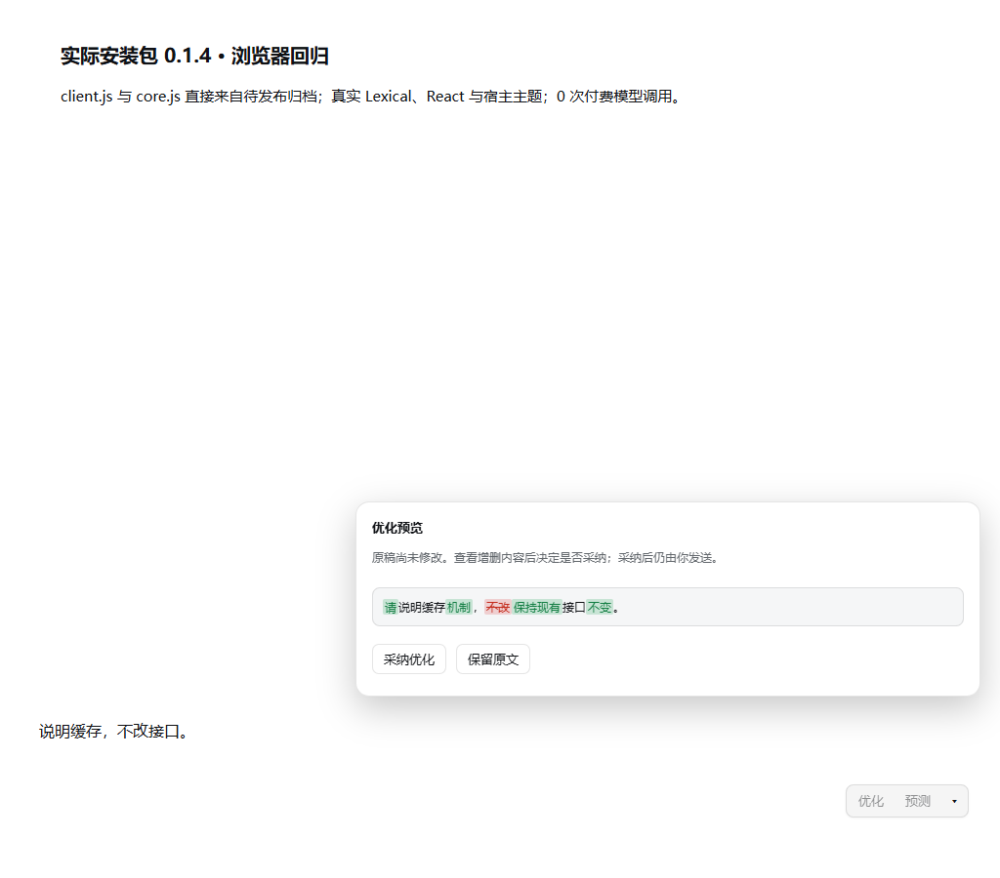

# DSH Input Assistant

[简体中文](README.md) | English

An input assistant for [DeepSeek Harness](https://github.com/deepseek-ai/deepseek-harness): rewrite drafts, suggest the next message or a continuation, and save drafts for later. Suggestions are never sent automatically.

The current source version is **0.1.4**. Build this checkout to install it locally, and check [Releases](https://github.com/Somnus678/dsh-input-assistant/releases) for published GitHub packages.



Screenshots use the production components and host theme in a local browser fixture with simulated model output.

## Features

- **Prompt optimization:** rewrite the whole draft or a selection with light, standard, or deep intensity. Review the diff and explicitly accept it; undo or restore the original afterward.
- **Predictions and completion:** show a candidate after a completed response or continue the current draft. Press Tab to accept, or Esc to dismiss. The independent Predict button also works when automatic suggestions are disabled; failed requests can be retried explicitly.
- **Detail and presets:** concise, standard, and detailed suggestions respect the configured character limit. Detailed suggestions can contain multiple lines and use a scrollable panel. Presets change the form and take effect only after saving.
- **Drafts:** save up to three drafts per session, then explicitly restore, append, copy, or delete them. Deletion has a ten-second undo window. During saving, Cancel clear keeps the editor contents while the save finishes.
- **Auxiliary model:** choose a model from the host catalog or enter provider and model IDs manually. This affects the plugin's calls only; it does not switch the main conversation model.

Recognized code, URLs, paths, and explicitly selected fragments are protected during rewriting. Altered or missing protection markers cause the result to be rejected. Automatic recognition and marker preservation do not guarantee semantic correctness: review the preview, and quote or manually protect ambiguous paths and filenames.

## Requirements and installation

Node.js **22.19 or later** and DeepSeek Harness are required. The declared DSH range is `>=0.2.1-rc.2 <0.3.0-0`; this build's dependency tests use `0.2.1-rc.3`. The complete native host and every version in that range have not been tested.

Build from this checkout:

```powershell
pnpm install --frozen-lockfile
pnpm build
pnpm pack --pack-destination dist
```

Install the local package into a Web profile:

```powershell
dsh --version
dsh plugin --profile web add (Resolve-Path './dist/dsh-input-assistant-0.1.4.tgz').Path
dsh --profile web --dump-config
dsh --profile web
```

For the Windows desktop profile, use the CLI bundled with the desktop application:

```powershell
$dsh = Join-Path $env:LOCALAPPDATA 'Programs\DeepSeek Harness\resources\runtime\cli\bin\dsh.cmd'
& $dsh plugin --profile desktop add (Resolve-Path './dist/dsh-input-assistant-0.1.4.tgz').Path
```

Completely quit and restart the relevant DSH instance after installation or upgrade. To remove the Web plugin, run `dsh plugin --profile web remove dsh-input-assistant` and restart. Uninstalling does not remove saved plugin settings or drafts from host storage.

If another archive was previously installed under the same 0.1.4 version, verify its source and SHA256 and check the plugin files actually loaded after restart. A same-version cache can reuse old files; the version number alone does not confirm that the new build was loaded.

## Getting started and settings

After restarting, use **Optimize** or **Predict** next to the input, and open the assistant menu for draft operations. Full settings are under **Settings → Input Assistant** and apply to all conversations. Labels in the current interface are in Chinese.

Automatic next-message prediction and completion are **enabled by default** and invoke the configured model. Disable both in settings if you only want explicit requests. Optimization and draft saving are also enabled by default.

| Setting | Default | Range / choices |
|---|---:|---|
| Optimization intensity | Standard | Light, standard, deep |
| Prediction detail | Standard | Concise, standard, detailed |
| Display | Ghost | Ghost text or panel; detailed mode uses the panel |
| Next-message limit | 120 | 20–1000 Unicode characters |
| Completion limit | 80 | 10–500 Unicode characters |
| Completion debounce | 600 ms | 200–5000 ms |
| Minimum completion interval | 2000 ms | 500–30000 ms |
| Auxiliary model | Follow composer | Catalog selection or provider/model pair |

Manual suggestions require an idle, visible, connected plain-text composer without attachments or references, with the caret at the end. The host's minimum interval still applies; a throttled manual request is delayed at most once. Hiding the page suppresses automatic suggestions. During draft saving, edits, model changes, or settings changes preserve the current editor contents and save only the original snapshot.

## Privacy and limitations

The plugin does not collect telemetry. Drafts and settings are stored by DSH; model calls go through the provider configured in the host. Draft text and relevant context are sent to that provider for optimization and suggestions. The plugin does not store API keys. See [SECURITY.md](SECURITY.md) for reporting and privacy details.

The 60-case model quality evaluation remains `not_evaluated`; a six-call historical smoke comparison does not establish comparative quality. Native operating-system IME composition, full desktop and other-plugin combinations, and non-Windows platforms have not been verified for this build. Consult [validation](docs/validation.md) and [the small model comparison](docs/smoke-comparison.md) for the actual evidence and its limits.

## Development and verification

```powershell
pnpm install --frozen-lockfile
pnpm typecheck
pnpm build
pnpm pack --pack-destination dist
pnpm test                 # full suite, including Edge theme tests
pnpm test:package         # strict consumers and actual archive
pnpm test:web             # source components in Edge
pnpm test:package:web     # archive client/core in Edge, local RPC fixture
pnpm eval:validate
```

Edge browser tests require Microsoft Edge. The package browser fixture uses local model and RPC replacements; the official Loader/Gateway tests cover the host integration separately. Linux CI excludes Edge-only tests. See [CONTRIBUTING.md](CONTRIBUTING.md) for the contribution workflow and [CHANGELOG.md](CHANGELOG.md) for release notes.

Pushing a `v*` tag triggers the npm publishing workflow after CI and requires the repository's `NPM_TOKEN`. It does not create a GitHub Release; create one separately and attach the validated archive if GitHub downloads are desired. Confirm that the tag, package version, and archive match and that the version has not already been published.

## License

[MIT](LICENSE). Third-party dependencies and reference implementations retain their own licenses; see [references](docs/references.md).
