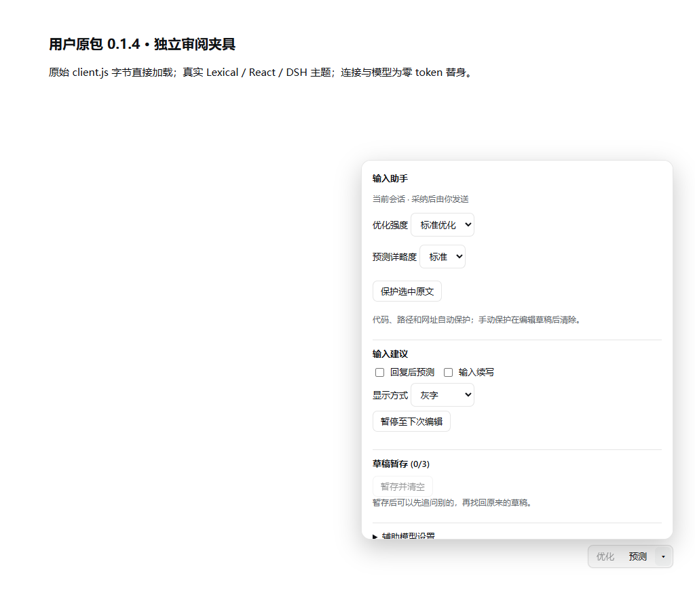
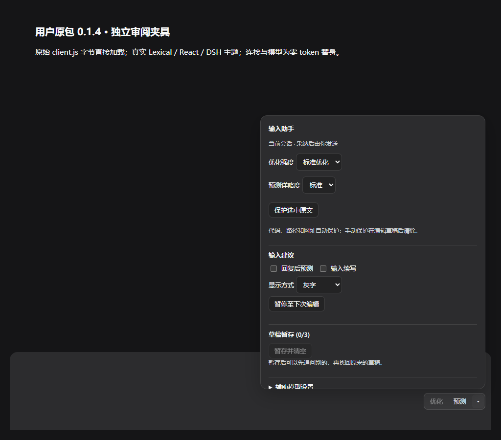

# DSH 输入助手

简体中文 | [English](README.en.md)

[](https://github.com/Somnus678/dsh-input-assistant/actions/workflows/ci.yml)
[](https://github.com/Somnus678/dsh-input-assistant/releases)
[](LICENSE)
[](https://github.com/deepseek-ai/deepseek-harness)
[](docs/validation.md)

[DeepSeek Harness](https://github.com/deepseek-ai/deepseek-harness) 的输入框增强插件：**提示词优化**、**下一句预测**、**输入续写**、**草稿暂存**。

当前源码版本为 **0.1.4**，包含预测详略度、预设、独立预测按钮、预览采纳、手动重试、草稿复制及辅助模型选择。可从当前源码构建并安装本地 `dist/dsh-input-assistant-0.1.4.tgz`；公开发布情况请参见 [Releases](https://github.com/Somnus678/dsh-input-assistant/releases)。



截图来自本地浏览器夹具，使用正式组件、宿主主题及模拟模型输出。

## 功能

| 功能 | 说明 |
|---|---|
| **提示词优化** | 把草稿或选中文字改写成更准确、可发送的表达。三档强度（轻/标准/深度），先预览差异，采纳后写入，可还原。 |
| **下一句预测** | 回复完成后预测你接下来可能说的话，以灰字提示，Tab 采纳，不发送。 |
| **输入续写** | 根据当前草稿预测后续内容，停顿时间与最小间隔可调。 |
| **手动建议与重试** | 点击独立「预测」按钮生成一次；自动建议关闭时仍可使用，失败后可明确重试。 |
| **详略度与预设** | 简明、标准、详尽三档；详尽允许多行，始终遵守长度上限。三种预设经保存后生效。 |
| **草稿暂存** | 当前会话最多保留 3 份草稿，点击“暂存并清空”先保存再清空，显式恢复；删除后 10 秒内可撤销。 |

深色与浅色主题均已适配：

| 浅色 | 深色 |
|---|---|
|  |  |

### 保护机制

改写时会识别并锁定以下内容：

- 代码块（``` 和 ~~~）与行内代码
- URL（含平衡括号）与盘符绝对路径（`C:\...`）
- 正斜线或反斜线相对路径与常见文件名（`src/core/generation.ts`、`src\index.ts`、`package.json`、`.env`、`.gitignore`）
- 你显式锁定的片段

占位符被模型篡改、丢失或重复时，插件拒绝该结果并保留你的原稿。

带空格的 Windows 路径支持引号边界，未加引号时会按文件名、标点或行尾识别。目录名和后续自然语言存在歧义时，请用引号、反引号或手动锁定，避免依赖自动识别。片段完整不等于语义不变，采纳前仍需审阅。

中文紧贴普通文件名时会切出文件本身，例如“请修改package.json中的scripts”。未引用的纯中文文件名与紧贴的中文说明仍可能存在歧义；混合中英文名称请使用引号、反引号或手动锁定。

### 失败不丢稿

优化、续写、预测在超时、取消、网络失败、模型空输出时都保留原稿，只给出提示。一次瞬时状态轮询失败不会中断正在进行的手动优化。

## 安装

需要 **Node.js >= 22.19** 和 **DSH `0.2.1-rc.2` 或 `0.2.1-rc.3`**。安装预构建 `.tgz` 不需要在本地编译 TypeScript。

构建本版后，将以下路径指向本地包并安装到 Web profile：

```powershell
dsh --version                                  # 确认 0.2.1-rc.2 或 rc.3
dsh plugin --profile web add (Resolve-Path './dist/dsh-input-assistant-0.1.4.tgz').Path
dsh --profile web --dump-config                # 应看到 dsh-input-assistant 层
dsh --profile web
```

已发布的 GitHub 安装包可从 [Releases](https://github.com/Somnus678/dsh-input-assistant/releases) 下载，请核对版本号和文件来源。

官方桌面端使用自己的 `desktop` profile（默认 Windows 安装位置）：

```powershell
$dsh = Join-Path $env:LOCALAPPDATA 'Programs\DeepSeek Harness\resources\runtime\cli\bin\dsh.cmd'
& $dsh --version
& $dsh plugin --profile desktop add (Resolve-Path './dist/dsh-input-assistant-0.1.4.tgz').Path
```

安装或升级后**完全退出并重新打开 DSH**，插件才会加载。

如果曾安装其他内容的同名 0.1.4 包，请先核对安装包的来源与 SHA256，并在重启后核对实际加载的插件文件。同版本缓存可能复用旧文件；仅看到版本号相同不能证明已更新。

### 卸载

```powershell
dsh plugin --profile web remove dsh-input-assistant
```

同样需要重启对应实例。卸载**不会**清除插件保存的草稿与设置（存在宿主私有 storage 中）。

### 从源码构建

```powershell
git clone https://github.com/Somnus678/dsh-input-assistant.git
cd dsh-input-assistant
pnpm install
pnpm build
pnpm pack --pack-destination dist
```

## 快速上手

1. 安装后重启 DSH，输入框右侧出现**「优化」「预测」按钮**和快捷菜单。
2. 在输入框写入草稿，点「优化」，查看差异后决定**采纳优化**或**保留原文**；等待期间可取消。
3. 左下角账号菜单 → **设置 → 输入助手**，可分别开关四个模块、调整强度与高级参数。

> **默认会调用模型。** `下一句预测` 和 `输入续写` 默认开启，会在你输入时自动发起请求。若只想手动使用优化功能或控制成本，请先在设置中关闭这两项。

## 设置项

| 设置 | 默认 | 范围 | 说明 |
|---|---|---|---|
| 提示词优化 | 开 | — | 是否启用优化 |
| 草稿暂存 | 开 | — | 是否启用“暂存并清空”与恢复 |
| 下一句预测 | 开 | — | 回复后是否预测下一句 |
| 输入续写 | 开 | — | 输入时是否预测后续内容 |
| 优化强度 | 标准 | 轻/标准/深度 | 改写幅度 |
| 预测详略度 | 标准 | 简明/标准/详尽 | 不会自动提高长度上限；详尽使用可滚动的候选面板 |
| 显示方式 | ghost | ghost/panel | 灰字或面板 |
| 下一句长度上限 | 120 | 20–1000 | Unicode 字符上限 |
| 续写长度上限 | 80 | 10–500 | Unicode 字符上限 |
| 续写停顿 `debounceMs` | 600 | 200–5000 | 停止输入多久后触发 |
| 最小间隔 `minIntervalMs` | 2000 | 500–30000 | 两次续写请求的最小间隔 |
| 固定辅助模型 | 跟随输入框 | — | 可从宿主目录选择；高级选项支持手填 provider/model；留空跟随输入框模型 |

### 各功能怎么用

**优化整稿或选区**：输入草稿后点「优化」。原稿保持不变，结果以差异视图展示；点「采纳优化」才写入输入框，点「保留原文」或按 `Esc` 放弃预览。采纳后可在菜单点「还原」，或按一次 `Ctrl+Z` 恢复原文。

**下一句预测与输入续写**：预测结果以**灰字**或候选面板显示。详尽模式统一使用可滚动的面板，完整展示多行候选。按 `Tab` 采纳，按 `Esc` 或继续输入忽略。采纳**不会**发送消息。

**手动生成与重试**：点击「预测」或菜单中的「生成建议」，空稿时预测下一句，有草稿时续写。自动功能关闭时仍可使用，失败或正常弃权后可明确重试。输入框需为无附件、无引用的空闲纯文本，光标位于末尾。手动请求仍遵守宿主最小间隔；限流时最多延后重试一次，不会循环调用。页面隐藏会停止自动建议，重新可见后再判断是否触发。

**暂存长草稿**：在菜单点击「暂存并清空」，保存成功后才清空输入（最多 3 份）。可显式追加或替换恢复；切换会话、切换模型、断线重连后暂存仍在该会话下。删除或清空暂存后，可在 10 秒内撤销；撤销不会覆盖其他窗口新保存的草稿，容量不足时会提示先释放空间再重试。

保存期间可点「取消清空」保留输入，已开始的保存仍会完成。保存中编辑草稿、切换模型或修改设置，也只保存原快照并保留当前输入。该按钮不用于取消删除或撤销等存储操作。

**预设档位**：「敏捷模式」「标准平衡」「节流省流」只修改设置表单，点击「保存设置」后才全局生效，不会立即生成。滑块用于快速调整，数值框支持范围内的精确整数，如 601 毫秒。

最近一次删除的 10 秒撤销期限不会因切走会话再返回而改变。撤销失败的目标单独保留在当前插件运行内，后续删除不会覆盖该目标；可重试、复制或主动放弃。两批备份均恢复失败时，会先要求处理一批，避免继续删除覆盖备份。插件卸载或连接切换会释放这些内存备份。草稿卡和待恢复备份都支持复制，复制不受当前输入附件或引用限制。

功能开关、显示方式、辅助模型和高级参数集中在 **设置 → 输入助手**，均为全局设置。快捷菜单只保留常用操作，并明确标注优化强度的全局作用范围。

辅助模型选择只保存插件自己的路由，不切换主会话模型；目录部分失败或不支持目录接口时，可刷新或使用高级手动填写，已有选择会保留。输入、优化和暂存的字数预算均按 Unicode 码点统计。

## 兼容性

| 项目 | 支持范围 |
|---|---|
| DSH | 声明 `>=0.2.1-rc.2 <0.3.0-0`；本轮测试依赖以 `0.2.1-rc.3` 为基准，完整宿主组合尚未验证 |
| Node.js | `>= 22.19` |
| 操作系统 | Windows x64（已验证）；macOS/Linux 未验证 |
| 浏览器测试 | Microsoft Edge |

## 已知边界

**这个插件没有完成完整的效果评测。** 请据此判断是否适合你的场景：

- 60 条固定合成质量集尚未跑完真实模型评测，也没有独立人工语义标注，状态为 `not_evaluated`。
- 6 次真实模型小样本对照只能说明链路可用（2,807 tokens），**不能证明效果优于同类工具**。
- 中文 IME 候选组合、附件/引用组合、完整官方 Web 组合、其他插件组合、非 Windows x64 平台均未验证。
- 声明允许 `0.2.1-rc.2` 至 `<0.3.0-0`；本版未对声明范围内每个宿主版本完成实机验证。

详见 [验收记录](docs/validation.md) 与 [低用量真实模型试验](docs/smoke-comparison.md)。

## 数据与隐私

- 不收集遥测，不上传使用数据。
- 草稿与设置存在宿主 DSH 的私有 storage。
- 模型调用走宿主已配置的提供商；插件不持有或记录 API key。
- 优化/预测/续写会把当前草稿与相关上下文发给模型提供商 —— 这是功能必需，请按你所用提供商的数据政策评估。

详见 [安全策略](SECURITY.md)。

## 开发

```powershell
pnpm install
pnpm typecheck     # 类型检查
pnpm test          # 全量工程回归（含 Edge）
pnpm build         # 构建 lib/
pnpm pack --pack-destination dist # 先生成当前版本归档
pnpm test:package  # 校验打包产物（需先 pack）
pnpm test:web      # 真实 Edge 回归
pnpm test:package:web # 直接加载实际 .tgz 的 client/core 做 Edge 回归
```

贡献前请阅读 [贡献指南](CONTRIBUTING.md)。技术细节见 [0.1.2 修正记录](docs/CHANGELOG-0.1.2.md)。

### 持续集成

每次 push 和 PR 都会在 GitHub Actions 上自动运行 [`.github/workflows/ci.yml`](.github/workflows/ci.yml)：

| Job | 环境 | 内容 |
|---|---|---|
| `test-windows` | `windows-latest` | 全量工程测试 + 源码与实际安装包的 Edge 回归 + 构建可复现性校验 |
| `test-linux` | `ubuntu-latest` | Node 22.19 与 24.19 矩阵，排除 Edge 专属渲染测试，验证核心/宿主/控制器及包消费者 |
| `package` | `ubuntu-latest` | 打包内容审计：必需文件齐全，且不含研究资料、缓存或测试夹具 |

`test-windows` 是权威结果：主题测试、`scripts/smoke-web.mjs` 和 `scripts/smoke-package.mjs` 使用
`chromium.launch({ channel: 'msedge' })` 驱动真实 Microsoft Edge 渲染已发布的 DSH 主题，
浏览器检查在无 Edge 的 Linux 上无法运行，因此覆盖由 Windows job 提供。

本地想复现 Linux job：

```powershell
pnpm vitest run --exclude 'tests/browser-theme.test.ts'
```

发布流程复用完整 CI，全部任务通过后才下载并发布其中已验证的同一份 `.tgz`，同时校验 tag 与包版本一致。

推送 `v*` 标签会触发 npm 发布工作流，需要仓库配置 `NPM_TOKEN`；该工作流不会自动创建 GitHub Release。如需在 GitHub 提供下载，需在 CI 成功后另行创建 Release 并附上已验证的归档。发布前应确认版本号、标签和归档一致，且该版本尚未发布。

## 许可证

[MIT](LICENSE)。第三方依赖与参考实现各自适用其原许可证，见 [公开参考与实现边界](docs/references.md)。
