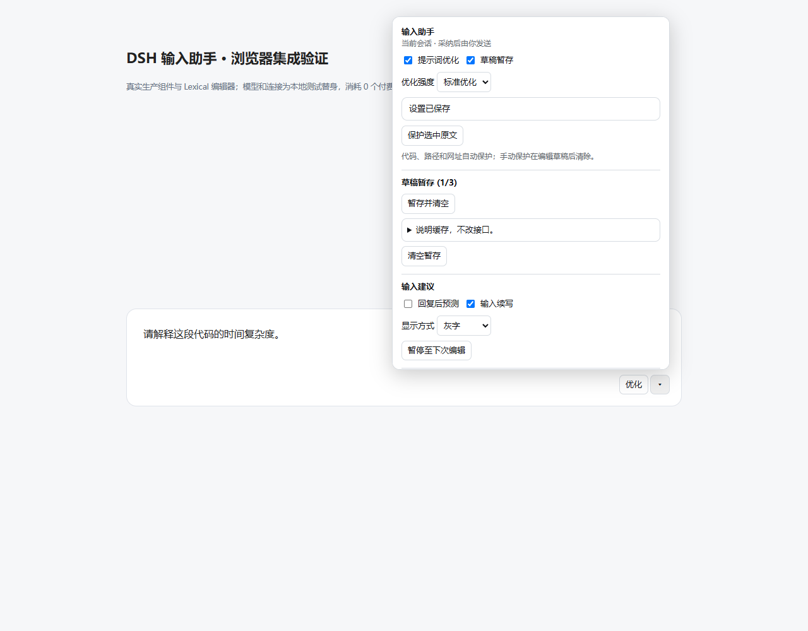
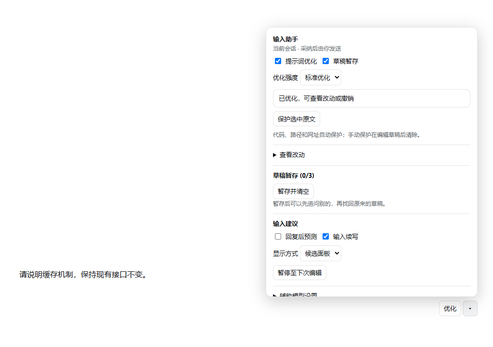
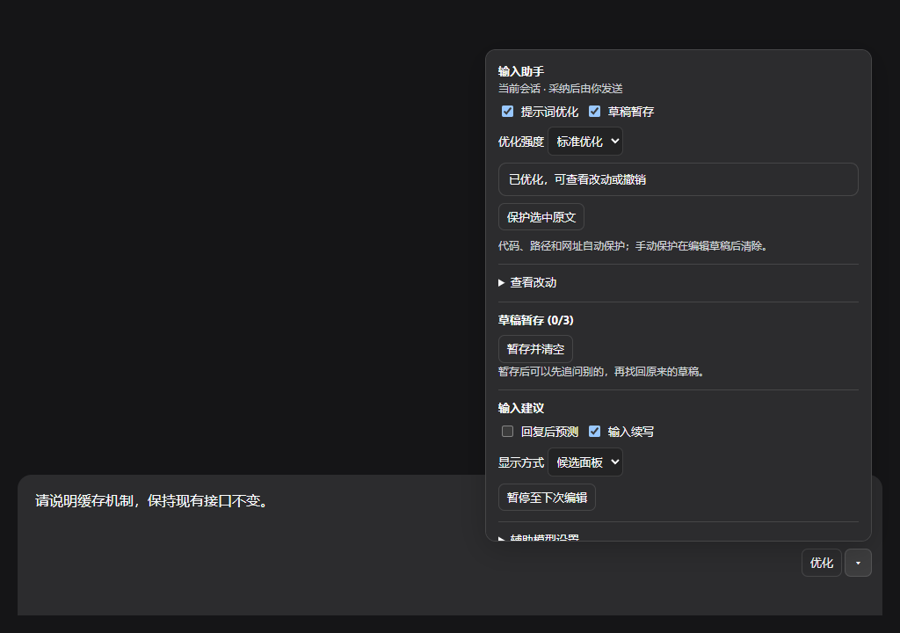

# DSH 输入助手

[](https://github.com/Somnus678/dsh-input-assistant/actions/workflows/ci.yml)
[](https://github.com/Somnus678/dsh-input-assistant/releases/tag/v0.1.2)
[](LICENSE)
[](https://github.com/deepseek-ai/deepseek-harness)
[](docs/validation.md)

[DeepSeek Harness](https://github.com/deepseek-ai/deepseek-harness) 的输入框增强插件：**提示词优化**、**下一句预测**、**输入续写**、**草稿暂存**。



## 功能

| 功能 | 说明 |
|---|---|
| **提示词优化** | 把草稿或选中文字改写成更准确、可发送的表达。三档强度（轻/标准/深度），显示逐词差异，一键撤销。 |
| **下一句预测** | 回复完成后预测你接下来可能说的话，以灰字提示，Tab 采纳，不发送。 |
| **输入续写** | 根据当前草稿预测后续内容，停顿时间与最小间隔可调。 |
| **草稿暂存** | 当前会话最多保留 3 份草稿，清空输入前自动保存，显式恢复。 |

深色与浅色主题均已适配：

| 浅色 | 深色 |
|---|---|
|  |  |

### 保护机制

改写时以下内容保持原样，模型无法篡改：

- 代码块（``` 和 ~~~）与行内代码
- URL 与盘符绝对路径（`C:\...`）
- 相对路径与文件名（`src/core/generation.ts`、`package.json`、`README.md`）
- 你显式锁定的片段

占位符被模型篡改、丢失或重复时，插件拒绝该结果并保留你的原稿。

### 失败不丢稿

优化、续写、预测在超时、取消、网络失败、模型空输出时都保留原稿，只给出提示。一次瞬时状态轮询失败不会中断正在进行的手动优化。

## 安装

需要 **Node.js >= 22.19** 和 **DSH `0.2.1-rc.2`**。安装预构建 `.tgz` 不需要在本地编译 TypeScript。

一行命令直接从 GitHub Release 安装：

```powershell
dsh --version                                  # 确认 0.2.1-rc.2
dsh plugin --profile web add https://github.com/Somnus678/dsh-input-assistant/releases/download/v0.1.2/dsh-input-assistant-0.1.2.tgz
dsh --profile web --dump-config                # 应看到 dsh-input-assistant 层
dsh --profile web
```

也可以先从 [Releases](https://github.com/Somnus678/dsh-input-assistant/releases) 手动下载 `dsh-input-assistant-0.1.2.tgz` 再本地安装：

```powershell
dsh plugin --profile web add ./dsh-input-assistant-0.1.2.tgz
```

官方桌面端使用自己的 `desktop` profile（默认 Windows 安装位置）：

```powershell
$dsh = Join-Path $env:LOCALAPPDATA 'Programs\DeepSeek Harness\resources\runtime\cli\bin\dsh.cmd'
& $dsh --version
& $dsh plugin --profile desktop add (Resolve-Path './dsh-input-assistant-0.1.2.tgz').Path
```

安装或升级后**完全退出并重新打开 DSH**，插件才会加载。

### 卸载

```powershell
dsh plugin --profile web remove dsh-input-assistant
```

同样需要重启对应实例。卸载**不会**清除插件保存的草稿与设置（存在宿主私有 storage 中）。

### 从源码构建

```powershell
git clone https://github.com/Somnus678/dsh-input-assistant.git
cd dsh-input-assistant
pnpm install
pnpm build
pnpm pack --pack-destination dist
```

## 快速上手

1. 安装后重启 DSH，输入框右侧出现**「优化」按钮**。
2. 在输入框写入草稿，点「优化」或按快捷键，查看差异后决定**采纳**或**撤销**。
3. 左下角账号菜单 → **设置 → 输入助手**，可分别开关四个模块、调整强度与高级参数。

> **默认会调用模型。** `下一句预测` 和 `输入续写` 默认开启，会在你输入时自动发起请求。若只想手动使用优化功能或控制成本，请先在设置中关闭这两项。

## 设置项

| 设置 | 默认 | 范围 | 说明 |
|---|---|---|---|
| 提示词优化 | 开 | — | 是否显示优化入口 |
| 草稿暂存 | 开 | — | 清空输入前是否自动保存 |
| 下一句预测 | 开 | — | 回复后是否预测下一句 |
| 输入续写 | 开 | — | 输入时是否预测后续内容 |
| 优化强度 | 标准 | 轻/标准/深度 | 改写幅度 |
| 显示方式 | ghost | ghost/panel | 灰字或面板 |
| 续写停顿 `debounceMs` | 600 | 200–5000 | 停止输入多久后触发 |
| 最小间隔 `minIntervalMs` | 2000 | 500–30000 | 两次续写请求的最小间隔 |
| 固定辅助模型 | 跟随输入框 | — | 可指定 provider/model；留空则跟随输入框所选模型 |

### 各功能怎么用

**优化整稿或选区**：输入草稿后点「优化」，或用菜单/快捷键。结果以差异视图展示，逐处标出增删；点「采纳」写入输入框，点「撤销」或按一次 `Ctrl+Z` 恢复原文。

**下一句预测与输入续写**：预测结果以**灰字**显示在光标后。按 `Tab` 采纳，按 `Esc` 或继续输入忽略。采纳**不会**发送消息。

**暂存长草稿**：清空输入前，非空草稿会自动暂存到当前会话（最多 3 份）。从插件菜单可查看并显式恢复；切换会话、切换模型、断线重连后暂存仍在该会话下。

## 兼容性

| 项目 | 支持范围 |
|---|---|
| DSH | `0.2.1-rc.2`（锁定） |
| Node.js | `>= 22.19` |
| 操作系统 | Windows x64（已验证）；macOS/Linux 未验证 |
| 浏览器测试 | Microsoft Edge |

## 已知边界

**这个插件没有完成完整的效果评测。** 请据此判断是否适合你的场景：

- 60 条固定合成质量集尚未跑完真实模型评测，也没有独立人工语义标注，状态为 `not_evaluated`。
- 6 次真实模型小样本对照只能说明链路可用（2,807 tokens），**不能证明效果优于同类工具**。
- 中文 IME 候选组合、附件/引用组合、完整官方 Web 组合、其他插件组合、非 Windows x64 平台均未验证。
- 目标 DSH 版本锁定 `0.2.1-rc.2`；其他版本可能不兼容。

详见 [验收记录](docs/validation.md) 与 [低用量真实模型试验](docs/smoke-comparison.md)。

## 数据与隐私

- 不收集遥测，不上传使用数据。
- 草稿与设置存在宿主 DSH 的私有 storage。
- 模型调用走宿主已配置的提供商；插件不持有或记录 API key。
- 优化/预测/续写会把当前草稿与相关上下文发给模型提供商 —— 这是功能必需，请按你所用提供商的数据政策评估。

详见 [安全策略](SECURITY.md)。

## 开发

```powershell
pnpm install
pnpm typecheck     # 类型检查
pnpm test          # 121 条测试
pnpm build         # 构建 lib/
pnpm test:package  # 校验打包产物（需先 pack）
pnpm test:web      # 真实 Edge 回归
```

贡献前请阅读 [贡献指南](CONTRIBUTING.md)。技术细节见 [0.1.2 修正记录](docs/CHANGELOG-0.1.2.md)。

### 持续集成

每次 push 和 PR 都会在 GitHub Actions 上自动运行 [`.github/workflows/ci.yml`](.github/workflows/ci.yml)：

| Job | 环境 | 内容 |
|---|---|---|
| `test-windows` | `windows-latest` | **全量 121 条测试** + 真实 Edge 冒烟 + 构建可复现性校验 |
| `test-linux` | `ubuntu-latest` | 排除 Edge 专属渲染测试（116 条），验证核心/宿主/控制器无 Windows 假设 |
| `package` | `ubuntu-latest` | 打包内容审计：必需文件齐全，且不含研究资料、缓存或测试夹具 |

`test-windows` 是权威结果：`tests/browser-theme.test.ts` 和 `scripts/smoke-web.mjs` 使用
`chromium.launch({ channel: 'msedge' })` 驱动真实 Microsoft Edge 渲染已发布的 DSH 主题，
这两项在无 Edge 的 Linux 上无法运行，因此 Linux job 显式排除它们，覆盖由 Windows job 提供。

本地想复现 Linux job：

```powershell
pnpm vitest run --exclude 'tests/browser-theme.test.ts'
```

## 许可证

[MIT](LICENSE)。第三方依赖与参考实现各自适用其原许可证，见 [公开参考与实现边界](docs/references.md)。
